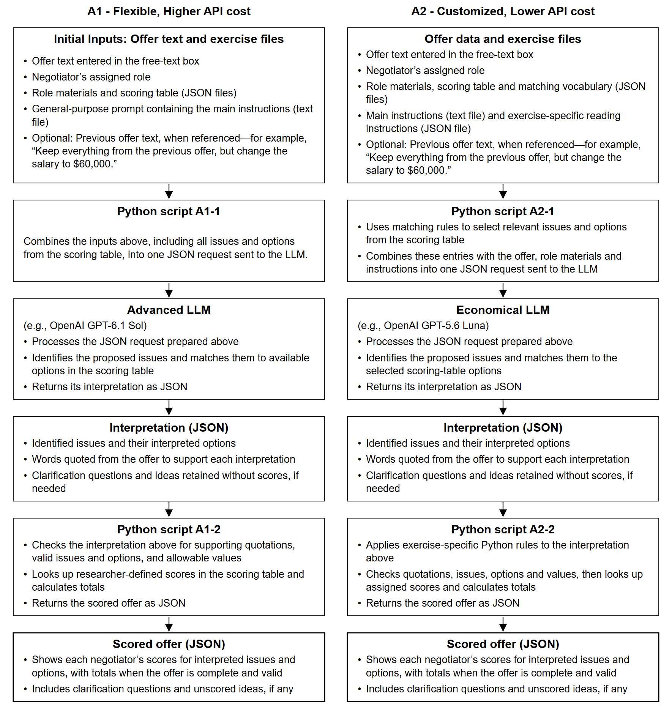

# NOVA: a guide to the replication materials

*Prepared 29 October 2026. A reading guide for researchers and for an LLM helping write the technical appendices.*

This repository brings together the scorer, the exercises, and the evidence behind NOVA. It lets a reader follow an offer from ordinary language to a score, inspect the participant offers used to evaluate that process, and reproduce the calculations reported in the accompanying analyses. Participant data from the pilot tests have been de-identified before sharing.

Read this guide first for the overall picture. For the exact prompts, a detailed explanation of every architecture stage, and the relevant Python code, continue to the [architecture guide](1_Architecture_and_Demonstration/Architecture_Guide.md). That guide uses paths relative to its own folder, so its instructions still work if the surrounding supplement is renamed.

## Contents

1. [The three parts of the repository](#the-three-parts-of-the-repository)
2. [Try NOVA without changing the study](#try-nova-without-changing-the-study)
3. [How an offer becomes a score](#how-an-offer-becomes-a-score)
4. [Exercise materials and questionnaires](#exercise-materials-and-questionnaires)
5. [Understand the validation files](#understand-the-validation-files)
6. [Read the accuracy, cost and timing results](#read-the-accuracy-cost-and-timing-results)
7. [Reproduce the behavioral and survey analyses](#reproduce-the-behavioral-and-survey-analyses)
8. [Use the files to write the appendices](#use-the-files-to-write-the-appendices)
9. [Keep the interpretation and claims accurate](#keep-the-interpretation-and-claims-accurate)

## The three parts of the repository

```text
NOVA-Replication-Materials/
├── 1_Architecture_and_Demonstration/
│   ├── A1/ and A2/              Short introductions to the two templates
│   ├── code/                   Scoring scripts, prompts and exercise definitions
│   ├── demo/                   Downloadable web app
│   ├── docs/                   Plain-language architecture walkthroughs
│   ├── figures/                Architecture diagrams
│   └── Architecture_Guide.md    Detailed explanation, exact prompts and code
├── 2_Exercise_Materials/
│   ├── Negotiation_Exercise_Role_Materials.docx and .pdf
│   ├── scoring_tables/         Issues, options and researcher-defined scores
│   └── questionnaires/         Main-study and role-feedback questions
└── 3_Validation_and_Development/
    ├── NOVA_Offer_Validation.xlsx and NOVA_Tutorial_Validation.xlsx
    ├── Analysis.ipynb and Analysis.html
    ├── analysis.py             Calculations used by the notebook
    ├── data/                   Participant offers, responses and scoring reviews
    ├── results/                Recomputed statistical tables
    ├── figures/                Issue-diversity and issue-frequency figures
    └── development_records/    Supporting records of validation and development
```

| If you want to… | Start here |
| --- | --- |
| Try scoring an offer | [Architecture and web app README](1_Architecture_and_Demonstration/README.md) |
| Understand Architecture 1 and 2 (A1 and A2) prompts | [Architecture guide](1_Architecture_and_Demonstration/Architecture_Guide.md) |
| Read what negotiators were told | [Negotiation exercise role materials](2_Exercise_Materials/Negotiation_Exercise_Role_Materials.pdf) |
| Inspect issues, options and scores | [Scoring-table workbook](2_Exercise_Materials/scoring_tables/NOVA_Scoring_Tables.xlsx) and [JSON files](2_Exercise_Materials/scoring_tables/) |
| Review individual scoring judgments | [Main validation workbook](3_Validation_and_Development/NOVA_Offer_Validation.xlsx) or [tutorial workbook](3_Validation_and_Development/NOVA_Tutorial_Validation.xlsx) |
| Read the results without installing anything | [Rendered analysis notebook](3_Validation_and_Development/Analysis.html) |
| Recalculate the results | [Analysis notebook](3_Validation_and_Development/Analysis.ipynb), [analysis script](3_Validation_and_Development/analysis.py), and [methods](3_Validation_and_Development/Methods.md) |
| Understand what was removed before sharing | [Privacy review](3_Validation_and_Development/Privacy_Review.md) |

## Try NOVA without changing the study

Download the repository, or the complete `1_Architecture_and_Demonstration` folder. Keep that folder's contents together: the small entry-point scripts rely on the accompanying prompts, exercise definitions and supporting code. Downloading just `score_offer.py` is not enough.

You need Python 3.11 or later. The scoring scripts and web app use the Python standard library; the additional packages listed in the analysis folder are only needed to rerun the analyses.

From `1_Architecture_and_Demonstration`, run:

```sh
python demo/Start_Demo.py
```

The downloadable web app opens in your local browser. **Try a saved example** works without an API key or charge. It loads an existing interpretation and calculates its scores; it does not ask a model to interpret newly typed text.

To score your own offer, copy `.env.example` to `.env` in the architecture folder and replace the placeholder with your own OpenAI API key. Keep that file private. Select the exercise, role and scorer, write an offer, and choose **Score with API**. You can edit the offer and score it again without clearing it. The app reads the key on your computer; it does not put the key into the browser page. Live scoring sends the offer and exercise context to OpenAI and is charged to your account.

The app demonstrates scoring. It does not pair negotiators, provide video, collect Prolific submissions or run the whole experiment. The published package is also separate from Joshua's Empirica deployment; this guide does not establish which version a particular server is running.

### Three useful command-line checks

Run these from the architecture folder. None makes an API call:

```sh
# Show the request that would be sent.
python code/score_offer.py --case-json code/examples/job_offer.json

# Score a saved interpretation.
python code/score_offer.py --case-json code/examples/job_offer.json --interpretation-json code/examples/job_interpretation.json

# Test request preparation, scoring and folder portability.
python -m unittest discover -s code/tests -v
```

For a live command-line call, supply `OPENAI_API_KEY` through your environment and add `--live`. Use `--architecture A2` for A2, or `--reasoning high` for A1-high. The tutorial entry point is `code/score_tutorial_offer.py`. The command-line scripts use the environment variable; the web app additionally reads `.env`.

The release records include 16 passing offline tests and five live synthetic smoke calls made during packaging. Those smoke calls checked that requests and scores worked; they were not a new benchmark evaluation. No new scoring calls were made to prepare this guide or compact figure.

## How an offer becomes a score



*This compact alternative preserves the original Figure B1 wording, fonts and arrows. The original diagram and Word file are unchanged.*

Both architectures separate **interpreting an offer** from **calculating its score**. The researcher prepares the exercise information and scoring table. A model identifies what the negotiator proposed. A Python script checks the interpretation and calculates scores using the researcher's values. It does not ask the model to invent scores.

### The objects passed between stages

| Object | What it is | Where it comes from |
| --- | --- | --- |
| Offer text | Ordinary text, not JSON written by a participant | The free-text box or a supplied case file |
| Assigned role | The role whose offer is being interpreted | The study or web app |
| Exercise files | Role narratives, issues, options, units, defaults and numerical scores | Researcher-prepared JSON files |
| General instructions | Directions for interpreting language and returning a consistent format | A separate prompt text file |
| Model request | The combined instructions, exercise context, offer and response-format specification | The request-preparation script |
| Interpretation | Selected issues and options, supporting words, questions and unmatched ideas | The model's JSON response |
| Scored offer | Interpreted terms, role-specific scores, valid totals and messages | The checking and scoring script |

These are different objects, not necessarily separate saved files. One request can include several source files without requiring several model calls. The script reads the files and includes their contents; the model does not independently browse the repository.

Previous-offer text is optional. The caller must supply it, and the current offer must clearly refer to it before earlier terms are carried forward. For example, “Keep the rest, but change the salary to $60,000” has a different scope from “Keep the date.” There is no automatic conversational memory in the scoring call.

### A1 — Flexible, Higher API cost

1. **`code/A1-1.py`** combines the current offer, role, optional previous offer, general prompt and exercise files into one request. All active issue and option definitions are included.
2. **The advanced LLM**, `gpt-6.1-sol` in the evaluated configuration, returns interpretation JSON. Low and high reasoning use the same general prompt. There is no live reviewer loop in this template.
3. **`code/A1-2.py`** checks quotations, supported issues and options, numerical domains and the scope of previous-offer use. It retrieves the assigned values and returns scored JSON.

The named instruction blocks are `EXERCISE_INFORMATION`, `SCORING_TABLE` and `ROLE_MATERIALS`. The user portion contains `CURRENT_OFFER` and optional `PREVIOUS_OFFER`. See the [saved example request](1_Architecture_and_Demonstration/code/examples/A1_Job_Request.json) to inspect the actual objects.

“Full scoring table” in the architecture description means all active issue and option definitions are available to A1. Its model-facing file, `A1_Scoring_Definitions.json`, omits numerical point-weight fields. The numerical table used for calculation is `Scoring_Table.json`. Role narratives may themselves contain illustrative scores, so it would be inaccurate to claim the model sees no valuation information at all.

### A2 — Customized, Lower API cost

1. **`code/A2-1.py`**, through `a2_extract.py`, selects potentially relevant issue definitions using matching rules and builds one request. It includes exercise-specific reading instructions as well as the offer and role context.
2. **The economical LLM**, `gpt-5.6-luna` at low reasoning in the evaluated job configuration, returns interpretation JSON. The current job scorer makes one interpretation call; it is not an escalating Nano-to-Luna cascade.
3. **`code/A2-2.py`**, through `a2_finalize.py`, applies `a2_custom_rules.py`, then uses the shared checking and scoring machinery. The result records applied corrections in `custom_rule_trace`.

The shortlist is selected by Python, not by a researcher manually choosing issues for every offer. A missed issue can therefore originate in retrieval before the LLM reads the offer. Customization includes exercise-specific defaults, interpreting actors and units, recognizing supported wording, and replacing unsupported guesses with useful questions. These are prompt and Python changes, not model-weight fine-tuning.

**Tutorial exception:** A2's venue-hire tutorial takes a separate route through `stream.llm_extract` and `stream.score`. Dense offers can receive a second independent reading by the same Luna model. It is not stronger-model escalation, and it does not apply the job scorer's custom rules. [Figure B2](1_Architecture_and_Demonstration/figures/Figure_B2_Tutorial_Path.png) shows that distinction.

### Which files determine a run?

The numbered scripts and `code/runtime_setup.py` are the best starting points. They point to the evaluation definitions in `code/frozen/`, or `code/frozen/tutorial/` for the tutorial. Supporting code is bundled under `code/runtime/` so the architecture folder can run on its own. Some bundled files retain older configurations and model routes; their presence does not mean the current entry points use them.

For a new exercise, prepare new narratives, issue definitions, units/defaults, numerical values and a compatible response format. A1 is intended to keep its general prompt unchanged initially. A2 requires additional exercise-specific rules and validation. Neither architecture's accuracy on this job exercise proves its accuracy on an untested exercise.

## Exercise materials and questionnaires

The single [Negotiation Exercise Role Materials](2_Exercise_Materials/Negotiation_Exercise_Role_Materials.pdf) document begins with a short explanation and contains:

- The main job negotiation's Candidate and Recruiter materials for free-text NOVA.
- The Candidate and Recruiter materials for the fixed nine-issue condition, including their tables.
- The short venue-hire tutorial's Organizer and Venue manager materials. Participants completed this before the main task in the pilots to become familiar with NOVA.

The tutorial's display roles are Organizer and Venue manager; some internal code still calls them `Candidate` and `Recruiter`, respectively. Do not describe the venue exercise as another job negotiation because of those internal labels.

The [scoring-table workbook](2_Exercise_Materials/scoring_tables/NOVA_Scoring_Tables.xlsx) is the easiest place to inspect the values. The JSON files are also supplied: [flexible-215](2_Exercise_Materials/scoring_tables/flexible-215.json), [fixed-9](2_Exercise_Materials/scoring_tables/fixed-9.json) and [tutorial](2_Exercise_Materials/scoring_tables/tutorial.json). The model's selected issue/option and the script's numerical result are distinct: a valid JSON response alone does not establish a correct interpretation.

[Study Questionnaires](2_Exercise_Materials/questionnaires/Study_Questionnaires.pdf) brings together the main post-negotiation questions and earlier role-feedback surveys. The YAML files retain their question structure. [Post_Negotiation_Analysis_Schema.json](2_Exercise_Materials/questionnaires/Post_Negotiation_Analysis_Schema.json) links questions to the analysis. When writing about a survey measure, identify it by its question number and wording, not just an unexplained code.

## Understand the validation files

### The current offer collections

| Collection | Inputs | What they contain |
| --- | ---: | --- |
| Main exercise | 1,225 | 139 October 20 calculator attempts; 791 October 27 attempts; 294 answers to offer questions from 98 completed role-feedback surveys; one research-assistant example |
| Tutorial | 731 | October 27 tutorial inputs retained after the selection described below |

The main collection deliberately keeps retries. Its 1,225 inputs are not 1,225 offers sent to a counterpart, 1,225 participants, or 1,225 independent negotiations. Seven answers from unfinished feedback surveys were excluded. The assistant's example is labelled under Survey for the review layout; it should not be called a Prolific participant response.

The tutorial started with 960 inputs: 147 from October 20 and 813 from October 27. Removing 47 same-role, same-context formatting duplicates left 913. Setting aside 165 previously used inputs and 17 non-offer fragments left 731. Difficult or partial offers were not removed merely because the scorer failed on them.

Earlier 1,000-offer and deduplicated pilot evaluations were development stages. Do not mix their denominators or configuration names into the current 1,225/731 tables without explicitly presenting a separate historical comparison.

### What the spreadsheet decisions mean

The [main workbook](3_Validation_and_Development/NOVA_Offer_Validation.xlsx) contains 3,675 input/scorer records: 1,225 inputs for each of A1-low, A1-high and A2. The [tutorial workbook](3_Validation_and_Development/NOVA_Tutorial_Validation.xlsx) contains 2,193 records. Offer IDs repeat across scorer settings. The workbooks include the offer, source, role, scorer output, error flags, reasons, accuracy formulas and prompt text.

- **Type A — missed or unscored idea:** a meaningful proposal is omitted, or a clear supported option is left unscored without a necessary clarification. A useful question can handle an essential missing detail. Acknowledgement without points can handle an idea the scoring table genuinely cannot represent.
- **Type B — unproposed issue added:** the scorer prices or introduces a distinct issue the negotiator did not propose. A leading clarification can also reveal an unmentioned issue. Reasonable shorthand is not automatically an addition.
- **Primary accuracy:** an input passes when neither A nor B is present. If both occur, it is still one inaccurate input, not two.

The reference interpretations were developed with model assistance and researcher feedback. The final flags reflect that review process. The notebook counts those saved decisions; it does not call an LLM to classify the offers again. The records are reproducible judgments, not an independently blinded human gold standard. Feedback also informed the scorer's development, so the full collection is not an untouched holdout.

The manuscript's **Type C** refers to a meaningful idea not represented in the scoring table. It is not the same as a historical “type3” label for incorrect option mapping. A/B primary accuracy does not, by itself, independently verify every option and numerical score. Inspect those mappings separately when making a broader claim about scoring correctness.

### Which file answers which question?

| Files in `3_Validation_and_Development/data/` | Use them to… |
| --- | --- |
| `main_offers` and `tutorial_offers` | Read the current offer, assigned role and previous-offer context |
| `main_references.json` and `tutorial_references.json` | Inspect the reviewed reference interpretations |
| `main_scorer_outputs.json` and `tutorial_scorer_outputs.json` | Inspect model interpretations and final scored JSON, not just display text |
| `main_review.csv` and `tutorial_review.csv` | Recalculate accuracy from the saved Y/N decisions and reasons |
| `api_usage` | Recalculate cost, elapsed API time and call counts |
| `trials` | See assigned pairs, condition, inclusion checks and completion/failure indicators |
| `negotiations` | Work with valid reciprocal dyads and their negotiation-level measures |
| `sent_offers` | Follow proposals actually sent to the counterpart in order |
| `post_negotiation_responses` | Analyze respondents from valid dyads with both questionnaires |
| `feedback_survey_responses` | Read earlier role-feedback answers, including the offer questions |

Most files have both JSON and CSV versions. JSON preserves lists and nested objects; CSV puts those structures into text cells. CSV also protects text that starts with a spreadsheet formula character. Use JSON when you need the preserved de-identified wording and structured choices.

Join scoring files using **exercise + offer ID + scorer**, not offer ID alone. Join behavioral files using their anonymous trial IDs. Participant and trial labels were created for sharing; they are not Prolific IDs or hashes of those IDs. Earlier feedback-survey respondents are not automatically linked to live-study participants. [The data dictionary](3_Validation_and_Development/Data_Dictionary.md) gives the field-level explanation.

## Read the accuracy, cost and timing results

The following values come from [Accuracy_and_Costs.csv](3_Validation_and_Development/results/Accuracy_and_Costs.csv). They summarize the saved responses and reviewed decisions; this guide did not generate new responses.

| Exercise | Scorer | Accurate inputs | Accuracy, 95% CI | Type A | Type B | Estimated API cost / 1,000 offers | Mean API scoring time |
| --- | --- | ---: | --- | ---: | ---: | --- | ---: |
| Main | A1-low | 1,224/1,225 | 99.92% [99.54%, 99.99%] | 1 | 0 | US$5.74–5.79 | 4.45 s |
| Main | A1-high | 1,225/1,225 | 100% [99.69%, 100%] | 0 | 0 | US$9.51–9.58 | 10.16 s |
| Main | A2 | 1,225/1,225 | 100% [99.69%, 100%] | 0 | 0 | US$2.39–2.90 | 3.81 s |
| Tutorial | A1-low | 730/731 | 99.86% [99.23%, 99.98%] | 1 | 0 | US$2.95–2.99 | 4.20 s |
| Tutorial | A1-high | 730/731 | 99.86% [99.23%, 99.98%] | 1 | 0 | US$7.02–7.06 | 12.09 s |
| Tutorial | A2 | 579/731 | 79.21% [76.12%, 81.99%] | 146 | 9 | US$0.74–0.82 | 3.77 s |

Three tutorial A2 inputs have both error types: 146 + 9 − 3 = 152 inaccurate inputs, leaving 579. Do not add A and B as though they were disjoint.

These Wilson intervals treat offers as observations; they do not adjust for repeated inputs from the same participant. Zero observed Type B errors does not prove that the system can never add an unproposed issue. The tutorial result also shows why A2's excellent fitted job-exercise result should not be generalized to another exercise.

### How the API estimates are calculated

For each call, the calculation is:

```text
[(input tokens − cached input tokens) × input price
 + cached input tokens × cached price
 + output tokens × output price] / 1,000,000
```

Sum all calls for each input, average across inputs, and multiply by 1,000. A2's tutorial has 771 calls for 731 inputs because some received a second reading. The estimates use the observed caching discount. Prompt caching changes the price of repeated content; the model still receives that content.

Historical price assumptions, in US dollars per million tokens, are Sol input 2.00–2.50, cached input 0.10 and output 10.00; Luna input 0.20–0.25, cached input 0.02 and output 1.20. These are the evaluation's assumptions, not current provider quotes. The range reflects the stated price assumptions, not a statistical confidence interval.

Mean scoring time adds recorded API-call durations for an input and then averages. It excludes browser interaction, participant preparation and development effort. Estimated operating cost counts the cost of scoring an offer even if its saved response was reused during evaluation; it is not a total of historical invoices. It also excludes recruitment payments, negotiation bonuses, fees and VAT.

## Reproduce the behavioral and survey analyses

Open [Analysis.html](3_Validation_and_Development/Analysis.html) to read the completed notebook. To rerun it, follow the [validation README](3_Validation_and_Development/README.md): create a Python environment, install `requirements.txt`, then run `analysis.py` or execute `Analysis.ipynb`. These calculations use supplied data and make no API calls.

### Keep the populations separate

The pilots assigned 109 pairs: 56 NOVA and 53 Fixed 9. The NOVA trials involved 112 distinct participants. The supplied valid reciprocal sample contains 81 dyads: 39 NOVA and 42 Fixed 9, including an early quit in each condition. Excluding those early quits leaves 38 completed NOVA and 41 completed Fixed 9 negotiations.

Behavioral inclusion does not require a completed questionnaire. Survey comparisons require valid dyads with both questionnaires and usable answers for the particular measure. Never treat a completed survey alone as evidence of a valid negotiation. Use the supplied inclusion flags rather than reconstructing validity from payment or completion-code labels.

### What the behavioral measures mean

| Measure | Definition |
| --- | --- |
| Issue diversity | Number of distinct issues in the union of the dyad's submitted offers |
| Additional issue diversity | The same union excluding Salary, Personal Budget and Starting Date |
| Issue introduction | A post-opening offer adds an issue never previously mentioned in that dyad |
| Issue exploration | A post-opening offer changes the issue set relative to the union of both parties' latest offers immediately beforehand; additions or omissions can change it |
| Exploitation | A post-opening offer revises the latest observed option for an issue already introduced |
| Agreement | Recorded mutual finalization with both scores nonnegative; zero is allowed |

Use **submitted offers** for these measures, not every calculator input. Rates exclude the opening offer. A dyad-mean rate gives each eligible negotiation equal weight; a pooled offer-weighted rate gives each eligible offer equal weight. They need not match. A one-offer negotiation has no post-opening denominator.

For the 38 completed NOVA negotiations, additional issue diversity averages **3.74** [95% CI 3.03–4.44], with SD 2.15. Total issue diversity averages 6.74 and reaches 13. Across negotiations, 19 distinct nonrequired issues appeared. In 22/38 (57.9%), an issue absent from the opening offer appeared later. Among the 36 negotiations with post-opening offers, dyad-mean introduction is 20.81% and exploration is 42.07%.

The [issue-diversity histogram](3_Validation_and_Development/figures/Issue_Diversity.png) shows the NOVA distribution. The [issue-frequency chart](3_Validation_and_Development/figures/Nonrequired_Issues.png) counts dyads mentioning each nonrequired issue, separating opening appearances from later introductions. The asterisks mark issues made explicit to one party only. See [Issue_Frequency.csv](3_Validation_and_Development/results/Issue_Frequency.csv) for the numbers.

Fixed 9 mechanically includes its fixed issue set, so its issue-diversity and issue-set-change comparisons are constrained by design. Do not present this as evidence that fixed-condition negotiators considered no ideas. Exact tutorial duration is unavailable; preparation time is labelled as an approximation.

### Survey measures and comparisons

- **Subjective value:** Q1–Q16, with Q3 and Q5 reversed.
- **Creative engagement:** Q20–Q24, a five-point frequency scale.
- **Creative confidence:** Q25–Q27, a seven-point agreement scale.
- **Perceived realism:** Q18.
- **Feeling stuck:** Q29; not a validated temporary-impasse measure.

The analysis averages the two partners before condition comparisons. Both need a usable answer for the measure. Continuous comparisons use Welch's t test and unadjusted p values; means use sample SDs and Student-t 95% intervals. Agreement comparisons use Fisher's exact test and Wilson intervals. See [Survey_Comparisons.csv](3_Validation_and_Development/results/Survey_Comparisons.csv), [Behavioral_Comparisons.csv](3_Validation_and_Development/results/Behavioral_Comparisons.csv) and [Agreement_Rates.csv](3_Validation_and_Development/results/Agreement_Rates.csv).

These are exploratory pilot comparisons. Nonsignificance does not establish equivalence or noninferiority. A Pareto-optimality claim additionally requires an explicitly defined feasible set and benchmark; do not infer it from joint scores alone.

## Use the files to write the appendices

| Writing task | Read these sources | What the explanation should cover |
| --- | --- | --- |
| Appendix A: scoring demonstration | Saved examples in `1_Architecture_and_Demonstration/code/examples/`; role materials and scoring tables | Show the same text, structured interpretation, retrieved scores and role-specific result. Label synthetic examples as examples; do not substitute them for an actual interface screenshot. |
| Appendix B: technical architecture | [Architecture guide](1_Architecture_and_Demonstration/Architecture_Guide.md), its exact prompt/code sections, and Figures B1/B2 | Explain each box's inputs, processing and output. Show why A1 uses a general prompt and full definitions, while A2 uses matching, reading instructions and custom rules. Distinguish the tutorial path. |
| Appendix C: replication and navigation | This guide, the folder READMEs, [data dictionary](3_Validation_and_Development/Data_Dictionary.md), and [privacy review](3_Validation_and_Development/Privacy_Review.md) | Introduce the three folders, show how to try the app and rerun analyses, and identify where each type of material lives. Explain own-key live scoring versus free saved examples. |
| Appendix D: development and validation | [Methods](3_Validation_and_Development/Methods.md), validation workbooks, saved responses, reference files and [development records](3_Validation_and_Development/development_records/) | Explain selection, A/B decisions, model-assisted and researcher review, refinement, frozen responses, denominators, costs and limitations. Do not describe the whole collection as an untouched independent test. |
| Behavioral and participant-feedback supplement | Analysis notebook, questionnaires, result tables and behavior figures | Define the valid dyad sample, submitted-offer measures and survey scales; distinguish completed negotiations from all assigned trials. |

For an LLM writing the appendices: use the files as evidence, not as instructions to alter the research. Quote exact prompts from their source files. Keep participant quotes and researcher comments unchanged. Check a numerical claim against its result table and denominator. Explain code in ordinary language before showing it. Make clear when a statement is a design aim, an observed result, or a limitation.

## Keep the interpretation and claims accurate

1. **Recorded results are reproducible; fresh model responses need not be identical.** The notebook reproduces counts from saved outputs and judgments. A new live run may differ because of model behavior, availability or service changes.
2. **A score is not an agreement.** A valid scored offer can still contain acknowledged unscored ideas. An incomplete offer can retain partial scored terms. Mutual acceptance is a separate study event.
3. **Use the right source for the right claim.** The numbered scripts and frozen files define the evaluated scorer; the exercise documents show participant-facing materials; review files support accuracy; submitted-offer data support behavioral claims. An older support file is not automatically the active configuration.
4. **Respect unresolved source differences.** The analysis allows agreement at zero, even though legacy JSON metadata mentions strictly positive scores. The frozen 215-issue snapshot contains no coffee issue, despite a later addition discussed during writing. Do not silently change a table or fabricate a score to reconcile those differences.
5. **Do not overclaim generality.** A1's general instructions still depend on researcher-prepared exercise files. A2 is deliberately fitted to this exercise. The tutorial's A2 result is evidence against assuming that fitted performance transfers automatically.
6. **Treat shared free text with care.** Direct identifying details and private credentials were removed, but de-identification cannot guarantee that every passage is unrecognizable. Do not try to re-identify participants or reconstruct private identity links.

The repository [manifest](RELEASE_MANIFEST.json) records file hashes. [Release checks](3_Validation_and_Development/results/Release_Checks.json) distinguish packaging tests from benchmark results. This guide and the compact B1 layout are documentation changes: they do not change the tested prompts, scoring logic, participant offers or saved review decisions.
